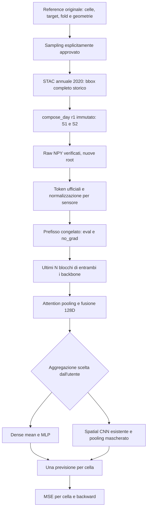

# Partial fine-tuning Medium: progetto implementato

Il nuovo percorso è `scripts/finetune_v2.py` → `biomap_finetune`. È separato dai comandi dense, r2-fast, Spatial CNN e dal vecchio `finetune.py`. Non avvia operazioni all'import. Encoder e strategia sono fissati a **GeoTESSERA V2 Medium + partial fine-tuning**; l'aggregazione resta `undecided` finché l'utente sceglie. Il codice disponibile non equivale a un esperimento scientifico eseguito.

## Flusso e responsabilità

`config.py` risolve YAML/extends e override, poi applica i gate. `data.py` verifica il reference attraverso il loader originale e la membership congelata; costruisce supporto, acquisisce dati e prepara batch di celle. `encoder.py` separa prefisso e suffisso effettivi. `validation.py` controlla checkpoint, forward, gradienti, aggiornamenti e parità campionaria degli input. `training.py` implementa controllo frozen, CV, refit e valutazione. `io.py` contiene transazioni/checkpoint/progress. `comparison.py` confronta due nuovi run appaiati. `cli.py` espone azioni e supervisione temporale dello smoke.

## Freezing verificato

Il checkpoint SHA256 obbligatorio è quello dell'audit. Non esiste fallback `strict=False`, download implicito o selezione di un altro encoder. Per N=2 si allenano `s2_backbone.transformer_encoder.layers.2/.3` e gli stessi layer di `s1_backbone`, con attention pooling e, per `train_output_projection: auto`, `dim_reducer`. La policy `train_normalization: auto` abilita le norm affine solo nelle regioni già sbloccate. `false` congela tutte le norm affine. La LayerNorm finale non affine conserva il proprio comportamento.

N=1/2/3 è esplicito. I conteggi reali, esclusa la testa, sono rispettivamente **6.494.594 / 11.208.818 / 15.923.042** parametri trainabili su 21.031.506. Il prefisso resta eval anche quando il modello passa in train. Il suffisso usa training e activation checkpointing non reentrant; la fusione trainabile mantiene il Dropout originale. Congelare la fusione ne congela i pesi, senza interrompere il gradiente verso il suffisso. Il checkpoint salva policy risolta, nomi e conteggi.

Il prefisso è eseguito in `no_grad`, non in `inference_mode`: le attivazioni ordinarie possono entrare nel suffisso autograd. La costruzione delle mappe usa indicizzazione e `index_copy` Torch; non converte gli embedding trainabili in NumPy. Il primo optimizer step verifica realmente quali pesi cambiano e rifiuta aggiornamenti di pesi congelati o un suffisso che non si aggiorna. Il gruppo encoder e il gruppo testa hanno learning rate distinti.

## Dati, campionamento e batch

Il benchmark conserva tutte le **127.909 celle di sviluppo nelle 17 AOI**, i tre fold originali, i target GLOBIO4 overall MSA 2020 e le **4.991 celle Liguria** esterne. Non vengono selezionate celle sulla base del target. Nessuna imputazione: una cella senza supporto o un pixel senza entrambe le modalità blocca la preparazione, senza ridurre silenziosamente il denominatore.

Tre opzioni restano alla decisione dell'utente. `full_support` mantiene ogni contributo storico, inclusi gli overlap tra tile. `uniform_pixels` seleziona K contributi deterministici **per cella complessivamente tra le tile**, senza sostituzione, o tutti se meno di K. `center_windows` mantiene una finestra nativa per cella e tile, centrata sul pixel eleggibile più vicino al centro del supporto. Una finestra ai bordi può contenere meno di lato² pixel. Celle su UTM 32/33 mantengono gruppi/patch separati; nessun mosaico o ricampionamento è aggiunto.

Le ultime due opzioni cambiano il supporto rispetto al dense storico: richiedono approvazione e un nuovo controllo frozen identico. Il sampling uniforme produce maschere sparse e non preserva automaticamente la semantica di una CNN spaziale. Lo smoke usa quattro celle di una AOI con finestre 2×2 **esclusivamente per verifica tecnica**, non come proposta definitiva di metodo. Non riduce le date annuali.

I batch contengono ID di cella, target, AOI/fold, gruppi raw per tile, geometria nativa, patch con dimensioni, posizioni valide, relazione patch→gruppo→cella. L'output è `[B]`, B celle, e la MSE si calcola su B target. Non si trasformano patch o pixel in osservazioni target indipendenti. L'inferenza del modello funziona senza target.

Dense Mean media tutti i contributi validi con il loro peso pixel, poi applica il `MeanMLP` già presente. Spatial CNN riusa `SpatialCNN` esistente: PartialConv, PixelNorm, GELU, pooling mascherato e aggregazione a cella. Le patch sono non sovrapposte e al massimo 64×64; il padding non entra nella maschera. La testa configurata è 64/32, hidden 64, dropout 0,1, output lineare, senza introdurre una nuova CNN o cambiare quella legacy. Nessun XGBoost entra nel grafo.

La standardizzazione degli embedding si misura una volta sull'encoder iniziale in eval, **solo sui pixel del training del fold**, con momenti FP64 e floor dello standard deviation 1e-6. Questi momenti restano fissi durante il fine-tuning e vengono salvati come buffer. L'opzione `none` è esplicita. Validation e Liguria non stimano la normalizzazione.

## Acquisizione e ripresa

L'acquisizione importa `streaming.compose_day` senza modificarlo: S2 bilineare, stesse bande/SCL/ordine scene, S1 `20*log10` float32, DOY reale incluso 366. I token usano gli helper ufficiali di binning, validità prima della normalizzazione e normalizzazione separata S1 asc/desc. Non si usa `data.power_to_storage` né il vecchio controllo DOY≤365.

I cataloghi esistenti possono essere copiati dalla root r1 in una nuova root di proprietà del fine-tuning. Le query mancanti sono consentite solo con `acquire`/`smoke`, sul bbox storico completo della tile anche se i pixel sono campionati. Non si restringe il catalogo al sottoinsieme. Il reader conserva timeout/retry r1; il wrapper STAC aggiunge un numero configurabile di tentativi. I/O per giorno con 1–4 thread, default 2; nessuna modifica dell'ordine di composizione delle scene.

Un primo passaggio legge i cataloghi annuali per calcolare l'ammissione sul disco con i **conteggi reali dei giorni**. Si considerano raw finali, copia giornaliera immutabile, indici e allowance per filesystem; non si promette una stima esatta del traffico COG. I blocchi default sono 8.192 pixel, non un'acquisizione annuale separata per ogni cella. Il confronto numerico con gli input storici resta necessario: finestre di riproiezione e librerie native possono produrre differenze che i soli test sintetici non escludono.

Ogni giorno e blocco raw è pubblicato come directory di NPY: temporanei unici, fsync, rilettura esatta, SHA256 e marker finale. I temporanei incompleti restano disponibili per diagnosi e non contano come completati. Non si cancellano dati legacy o checkpoint. `--resume` verifica e riusa i blocchi/giorni validi. Geometrie, celle e array hanno checksum; il loader usa memmap in sola lettura e copia soltanto i pixel della cella. Le funzioni di collate/worker sono a livello modulo e lo spawn è testato; default zero worker.

`doctor --verify-inputs` confronta fino a otto pixel selezionati per tile con i veri embedding frozen r2, verificando SHA del file e della geometria. Registra copertura, checkpoint, codice e tolleranze storiche 2e-5. È un controllo campionario dichiarato, non una prova al bit di tutti i pixel. Una discrepanza blocca il training; non si allargano automaticamente le tolleranze. La CLI non espone il profilo sintetico dei test come scorciatoia scientifica.

## Training, selezione e confronto

AdamW, MSE per cella, clipping e FP32 sono il percorso iniziale; AMP FP16/BF16 richiede scelta esplicita e CUDA. Nessuna riduzione automatica del numero di layer o cambio di precisione in caso di OOM. Il microbatch pixel e il batch celle sono distinti: il primo limita un forward, ma il grafo della cella può restare grande; non è una garanzia di VRAM costante.

`train --phase cv` esegue i tre fold AOI, early stopping sul macro-AOI RMSE e raccoglie una previsione OOF per cella. Aggiunge Dummy con media del **solo training del fold**. Le epoche di refit sono la mediana delle tre epoche migliori. `train --phase refit` allena tutte le celle di sviluppo per quel numero di epoche. Solo `evaluate` legge le 4.991 celle Liguria per predire; non le usa per early stopping, normalizzazione o scelta. Il test è già stato osservato e non va presentato come nuovo holdout intatto.

Le metriche riusano il report esistente: MAE, RMSE, R², bias, MAPE con soglia/esclusioni esplicite, macro AOI, fold, diagnostiche e confronto Dummy. I checkpoint sono immutabili per epoca: stato modello, optimizer, scaler, RNG Python/NumPy/Torch/CUDA, policy, epoca, best/stale/history e identità. La ripresa recupera il massimo checkpoint con marker verificato anche se il processo è caduto prima del pointer `latest.json`; un file senza marker non viene sovrascritto e la nuova pubblicazione usa un nome univoco. Rimangono tutte le epoche: pianificare anche il loro spazio, non solo i raw.

`--encoder-mode` è l'override `training.encoder_mode=frozen`: nuovo controllo con stessa testa, seed e input. Il comando `report --compare-run` rifiuta ID/target/fold/supporto differenti, aggregazioni o normalizzazioni incompatibili; non fa un inner join selettivo. Produce delta macro-AOI RMSE e intervallo bootstrap AOI appaiato. Le baseline dense V1/V2 e la Spatial CNN attuale devono essere analizzate separatamente quando pixel, seed o normalizzazione differiscono. Il confronto automatico con i vecchi CSV non è certificato da questa consegna.

## Stato operativo

`doctor` e `--dry-run` funzionano con aggregazione undecided. LR encoder/head, batch ed epoche del benchmark sono null e bloccano training. Lo smoke è supervisionato da un processo spawn con deadline massima 900 secondi, comprendente acquisizione, parità, train e metriche. Allo scadere interrompe solo il proprio worker: non garantisce che la rete abbia terminato il lavoro entro 15 minuti. Non accede ai processi universitari.

I progress JSON sono atomici e riportano fase, fatto/totale, velocità, ETA e fine prevista; l'ETA è una proiezione del lavoro osservato e il training può fermarsi prima per early stopping. Il monitor chiude il file prima di attendere. Gli indici e le cache r1/r2 esistenti non vengono scritti. La verifica reale CUDA/dati rimane necessaria prima di affermare `READY_FOR_REAL_TRAINING`.
