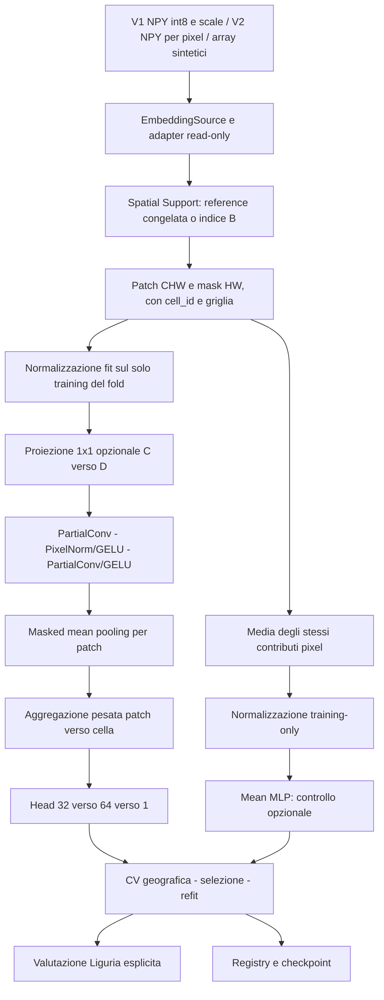

# Architettura della Spatial CNN modulare

Il package `biomap_spatial` è un percorso opt-in. A/B, r1 e r2-fast restano invariati. Non viene introdotta una Residual CNN: la baseline riusa esattamente PartialConv 3×3 e PixelNorm dell'Esperimento B attraverso import isolati; non espone i nomi generici `runtime/model/dataset` nel namespace globale.

## Componenti e contratti

`contracts.py` espone quattro famiglie: EmbeddingSource, SpatialSample/TabularSample, Predictor, ExperimentSpec. ModelConfig ed ExperimentProtocol sono configurazioni separate composte nella specifica. Il modello non riceve Rasterio, coordinate, nomi encoder o target per decidere la forma del batch. `cell_ids` definisce B, `owners` collega P patch alle B celle. Input float32 `[P,C,H,W]`, mask bool `[P,1,H,W]`; output `[B]`.

`sources.py` legge gli schemi r1/r2 separatamente e controlla reference, marker, SHA, dtype, griglia, ordine e legame delle mappe alle somme/conteggi originali. L'indice conserva solo finestre, maschere e momenti per cella in SQLite, riutilizzando il pattern B; non introduce un nuovo formato degli embedding. La preparazione committa una tile alla volta e pubblica il marker per ultimo. LRU memmap limitata, letture di finestre via ricerca negli indici ordinati, nessuna mappa rettangolare gigantesca per tutta la tile.

`V1TileAdapter` applica int8×scale float32 e ignora soltanto le scale non finite, come B. `V1IndexSource` rende utilizzabile un indice B già finalizzato e verificato senza modificarlo. La CLI prioritaria usa V2; per V1 si imposta `source.kind=v1_index`, `source.root` all'indice SQLite B e un feature_space_id V1 distinto. `ArraySource` serve alle prove sintetiche. Il runner non acquisisce embedding di futuri encoder: nuovi adapter possono implementare lo stesso contratto.

`support.py` separa appartenenza, finestre, bordi e diagnostica overlap dal backbone. Per V2 usa le geometrie/lookup congelate della reference, inclusa la convenzione legacy floor/trunc dichiarata; non rimappa retroattivamente i centri. Per geometrie generiche offre mask dei centri con CRS identico e nessuna riproiezione implicita. Le finestre non usano halo; le sovrapposizioni di tile preservano i contributi legacy e vengono contate. Il conteggio esatto dei centri usa coordinate native, senza deduplicazioni arbitrarie basate su arrotondamenti.

`normalization.py` riusa il fit pixel-weighted B. `cell_standard` è definita sui vettori di cella ed è rifiutata per la CNN; `none` è esplicita. Stato e ID training vengono salvati nel checkpoint. Non si aggiunge uno scaler nascosto nel modello. Fit su validation/Liguria viene rifiutato.

`model.py` conserva 64/32 e testa GELU 32→64→1. C è configurabile, testato a 32/128/384; l'opzione projected aggiunge Conv1×1 C→D. La variante pixelwise usa kernel 1 e lo stesso schema; il receptive field è 1, contro 5 per due convoluzioni 3×3. I parametri cambiano: il confronto non isola perfettamente la spazialità. Pesi di feature space differenti non vengono caricati automaticamente.

`engine.py` offre un solo modello per run, Dummy sugli stessi split, tre fold AOI, selezione macro-AOI RMSE OOF, refit con mediana delle epoche migliori e valutazione esterna separata. Accumulo e MSE sono pesati sulle celle, mai sul numero di patch. Checkpoint atomici con optimizer/scaler/RNG e ripresa all'ultima epoca completa. Inferenza senza target. AMP è opzionale CUDA; FP32 iniziale.

`cli.py` e `scripts/spatial_cnn.py` espongono doctor, prepare, preflight, profile, train, evaluate, compare e monitor. Doctor è inventario, non un certificato d'integrità. Il preflight completo precede qualsiasi query CUDA e richiede l'indice firmato. Il monitor legge/chiude subito l'avanzamento per preservare le scritture Windows. La CI esistente raccoglie automaticamente i nuovi test CPU.

## Registry e limiti

Default: `outputs/biomap_framework/index/` per l'indice; `outputs/biomap_framework/<run_id>/` per i run. Il registry comprende config effettiva, manifest con commit/hash/feature-space/protocollo, checkpoint, OOF ed esterno separati, metriche, diagnostiche e marker. I file sono privati e ignorati da Git; config locali possono contenere percorsi assoluti, quindi non vanno pubblicate senza revisione.

Le verifiche riguardano fixture sintetiche, non disponibilità delle mappe universitarie o miglioramenti MSA. Il test di parità B copia i pesi e confronta stessa rappresentazione e stesso supporto sintetico: non dimostra che il nuovo supporto V2 coincida automaticamente con ogni precedente run B. Il confronto tra encoder reali richiede prima un audit appaiato dei pixel/celle, non il solo uguale numero di righe.

La nuova pipeline non fa fine-tuning dell'encoder. Il [rapporto dedicato](finetuning_feasibility.md) distingue il forward differenziabile già presente dall'inferenza r1 e dagli input mancanti.
