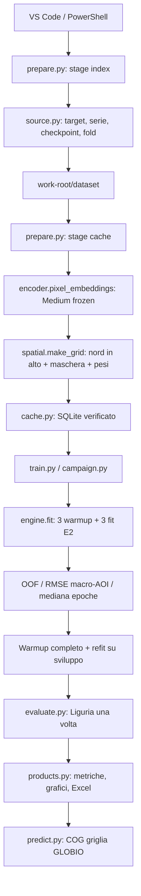

# Handover dell'implementazione E2 — Frozen CNN MSA

Data: 9 novembre 2026. Destinatari: colleghi che devono verificare il protocollo,
eseguire E2 sul PC universitario e successivamente implementare E4/E5.

## 1. Cosa è stato consegnato e cosa deve ancora essere dimostrato

È stato aggiunto un percorso E2 completo: audit in sola lettura, cache degli embedding
puntuali, CNN spaziale, tre fold geografici, refit, benchmark ligure, metriche, grafici,
Excel e mappe. Il codice è sviluppato in una copia indipendente `biomap-finetuning-dev`,
branch `finetuning-dev`, a partire da `741bca9f43b1fcfde509d3c47e98e81b0d506288`.

Non è stato avviato il training scientifico E2 né verificato il completamento del probing
universitario. I dati reali delle 132.900 celle non sono disponibili in questa copia Mac.
Le fixture usano un encoder ridotto e target sintetici; nessuna loro metrica è un risultato
di biodiversità. La prova CUDA, i tempi reali e la validità di tutti i file universitari
restano verifiche da eseguire sul PC con i comandi documentati.

**E4 ed E5 restano da implementare.** Non esistono in questa consegna checkpoint partial
o LoRA né risultati di confronto E2–E4–E5. Il codice legacy di fine-tuning rimane disponibile
ma non sostituisce gli esperimenti controllati futuri.

## 2. Audit iniziale e isolamento del probing

GitHub conteneva il merge delle modifiche universitarie delle quattro celle Puglia e il
report del primo probing. È stata verificata la base remota prima di creare il clone
separato. Il vecchio checkout locale aveva riferimenti Git iCloud `dataless`: non è stato
forzato, ripristinato o ripulito. Nessuna modifica è stata fatta al checkout universitario.

Il nuovo pacchetto `biomap_ml` legge soltanto funzioni legacy senza side effect: configurazione,
hash, verifiche geografiche, preprocessing/forward encoder e metriche. Non chiama `prepare`,
`weights` con download, `doctor` o `make_run` sulla data-root del probing. Anche i nuovi
lock e il registro Excel risiedono nella work-root separata.

La sorgente e la work-root vengono risolte tramite `Path.resolve()`: non possono essere
uguali o annidate. Un symlink esterno nella work-root viene rifiutato. La sorgente delle
serie deve rimanere entro la cartella sorgente. I run-id consentono solo nomi semplici.

Le criticità di acquisizione descritte nella revisione del 7 novembre **non sono state
corrette nel codice legacy** in questa consegna. E2 non usa i checkpoint giornalieri o il
coordinatore parallelo: verifica le serie consolidate, i manifest e i target prima di
generare feature. Questo riduce la dipendenza dagli stati di avanzamento ma non certifica
retroattivamente ogni passaggio di acquisizione.

## 3. Organizzazione: dove avviene ogni operazione

Non esiste un unico `main.py` che avvia automaticamente tutta la campagna. Le quattro
facciate esplicite separano i passaggi che un collega deve poter ispezionare e rilanciare.

| File | Funzioni/ruolo | Output principale |
|---|---|---|
| `configs/e2_msa.yaml` | Parametri dichiarati della campagna E2 | Configurazione versionata |
| `settings.py` | `configuration`, `command_context`, separazione percorsi, lock, budget e scritture atomiche | Contratto comune delle CLI |
| `source.py` | `build_index`, `verify_targets`, `verify_checkpoint`, `indexed` | `dataset/index.csv`, `audit.json` |
| `spatial.py` | `lattice`, `make_grid`, `stratum_weights`, `validate_raw`, `SpatialCNN` | Griglia, maschera, pesi, testa CNN |
| `cache.py` | `build_cache`, `PointDataset`, checksum per record | SQLite degli embedding puntuali |
| `engine.py` | `fit`, `predict`, `batch`, AMP e recupero OOM | Checkpoint, optimizer/scaler/RNG e storia |
| `campaign.py` | `train_campaign`, `evaluate_campaign` | CV, selezione, refit e test separato |
| `products.py` | Metriche, quintili, bootstrap, grafici, workbook, COG | CSV/JSON, PNG, XLSX, TIFF |
| `prepare.py` | CLI `--stage index/cache/all` | Avvio controlli o cache |
| `train.py` | CLI `--phase cv/refit/all`, `--resume` | Avvio training E2 |
| `evaluate.py` | CLI test Liguria + prodotti | Risultati del checkpoint finale |
| `predict.py` | CLI esportazione da predizioni verificate | GeoTIFF, senza nuovo training |
| `tools/check_environment.py` | Test minimo del device e dei percorsi | `environment.json` |
| `tools/profile_training.py` | Breve misura della CNN su cache reale | `profile_E2.json` |

I sette moduli funzionali principali restano separati dalle facciate CLI. Ogni nuovo file
Python è inferiore a 300 righe, con commenti iniziali e spiegazioni prima delle funzioni.
Gli script legacy in `scripts/` non sono stati duplicati o rimossi.

## 4. Identità dei dati e controlli prima del training

L'indice originale viene verificato contro `cells.json` e contro il manifest geografico
versionato. La validazione storica controlla 127.909 sviluppo, 4.991 Liguria, 17 AOI,
tre fold, membership, separazione AOI e assenza di Umbria nord. Sono inoltre confrontati
centri e bounds, non soltanto identificativi o numerosità.

Per il target il codice apre il raster già presente e verifica CRS EPSG:4326, risoluzione
10 arcsec, trasformazione non ruotata, posizione al centro delle celle, copertura e NoData.
Se il file è `msa_area_10sec.tif` nel protocollo ufficiale, controlla anche il denominatore
co-registrato e positivo prima della divisione. I valori devono coincidere con `cells.csv`
entro `1e-6`, rimanere finiti e in [0,1]. I checksum devono coincidere con quelli del prepare.

Per ogni serie vengono controllati SHA256, anno, protocollo, sampling, bande, bounds,
shape/dtype, DOY, punti e copertura. I DOY possono coincidere al cap 365 del contratto
ufficiale (30/31 dicembre bisestile): non sono trattati come date duplicate da eliminare.
L'audit verifica anche le soglie minime di osservazioni S1/S2 per ciascun punto conservato.

Le quattro celle Puglia ricevono `quality_flag=explicit_low_coverage`; tutte le altre
devono rispettare la soglia generale. Nessun target è imputato e nessuna cella viene
sostituita quando un controllo fallisce. La campagna si ferma indicando il vincolo.

## 5. Checkpoint e preprocessing TESSERA

Il Medium ufficiale ha circa 21 milioni di parametri e output 128D. Provenienza fissata:

- codice TESSERA: `e368539f7c4711e5f16fdd09801573830e34baf9`;
- pesi HF: `geotessera/TESSERA-V-2.0-2B-M`;
- revisione: `8c80b926f67cb0b44c2cd41d0226e61741503b9a`;
- SHA256: `3823be7db9d9cfc93f3c2a47c7699be82821ab4e1117d4d2befdb746941ee96e`.

Fonte tecnica: [README ufficiale al commit fissato](https://github.com/ucam-eo/tessera/blob/e368539f7c4711e5f16fdd09801573830e34baf9/tessera_infer_v2/README.md).
Ordine S2: B04, B02, B03, B08, B8A, B05, B06, B07, B11, B12. Il forward riusa la
normalizzazione e il binning ufficiali già verificati nei test legacy. Non si usano pesi
adattati per un altro task. Il checkpoint viene letto, mai riscritto nella sorgente.

La costruzione cache usa FP32, `eval()` e `requires_grad_(False)`; un hash dello stato
encoder prima/dopo controlla che parametri e buffer non cambino. L'encoder non viene
caricato durante il training E2 della testa.

## 6. Dalla serie alla cella: perché serve una nuova cache

Il probing storico riduceva i 25 embedding a una media di 128 componenti per cella.
Una CNN richiede invece posizioni spaziali: 25 vettori con coordinate verificabili.
Le coordinate assegnano ciascun punto a uno dei 25 strati, rifiutando duplicati,
posizioni fuori cella o non corrispondenti ai centri attesi. La riga zero è a nord.

La nuova cache conserva 3.200 float di feature, 25 di maschera e 25 di pesi per cella.
Il checksum del record include tutti questi valori; il metadato generale lega checkpoint,
serie, protocollo e precisione. Le transazioni ogni 64 celle limitano il lavoro perso
in caso di interruzione. Il lettore training apre SQLite in modalità `ro, immutable`.

La CNN ha **13.505 parametri addestrabili**: proiezione 129→32 (feature+mask), convoluzione
3×3, GroupNorm a 8 gruppi, ReLU, proiezione a 1 e sigmoid. La media finale è mascherata e
pesata per le aree degli strati. I mancanti non contribuiscono come zeri MSA.

Questa scelta preserva il supporto del target GLOBIO, ma non crea una supervisione per
ciascun punto Sentinel. La media pesata da strati è versionata e non viene retroapplicata
ai risultati storici basati sulla media semplice.

## 7. Training, selezione e refit: separare le evidenze

Ogni fold ha un warmup di 5 epoche e una continuazione E2 fino a 50 epoche, patience 8.
Il warmup è indipendente per fold; la validation non determina la sua durata. E2 riparte
dall'ultimo warmup, con optimizer nuovo. Questi checkpoint devono essere conservati per
inizializzare E4/E5 in modo comparabile, senza condivisioni supervisionate fra fold.

La selezione del checkpoint del fold usa RMSE macro-AOI della validation pertinente.
Le OOF aggregate coprono una volta tutte le celle di sviluppo; la selezione complessiva
usa RMSE medio delle 17 AOI. I Dummy sono medie dei soli training dei rispettivi fold.

Il refit usa la mediana delle epoche migliori post-warmup, ripete warmup su tutto lo
sviluppo e addestra per quel budget fissato senza validation. La Liguria viene filtrata
prima di costruire i dataset supervisionati. `final.json` registra il Dummy dell'intero
sviluppo e il checksum del checkpoint. Solo `evaluate` calcola le predizioni liguri.

Un rilancio di `evaluate` riusa il CSV e ne verifica il checksum. Non cambia il modello
in base al test, non effettua refit e non riscrive la sessione del probing.

## 8. Checkpoint, recupero interruzioni e OOM

Ogni checkpoint contiene testa, optimizer, scaler, RNG Python/NumPy/Torch/CUDA, epoca,
global step, microbatch, storia, migliore epoca e identità del fit. L'encoder frozen è
riferito tramite SHA, evitando di duplicarlo in ogni checkpoint della sola testa.

Il fingerprint comprende celle, target, serie, AOI, fold, configurazione e stato iniziale.
Il resume rifiuta cambiamenti, riparte dall'ultima epoca conclusa e ripete l'eventuale epoca
interrotta. Il checkpoint di inizio epoca è su disco; non viene duplicata tutta la VRAM.
Un OOM ripristina i pesi, optimizer, scaler e RNG e riduce soltanto il microbatch. Il batch
effettivo resta 16; l'ultima finestra usa il proprio numero reale di celle come denominatore.

`last.pt` consente resume; `best.pt` è la scelta di validation. Il refit usa `last.pt`
del budget fissato. Il salvataggio è atomico con file temporaneo e rename.

## 9. Risultati, Excel, grafici e mappe

Le tabelle riportano MAE, RMSE, MAPE con denominatori/zeri esclusi, bias predetto−target,
R², Pearson, MSA medio osservato/predetto e riduzione RMSE rispetto al Dummy. Esistono
righe aggregate, per AOI e per fold OOF. I CSV per cella mantengono coordinate, modello,
ruolo, fold, qualità, copertura ed errori assoluti/relativi.

Il MAPE non equivale a MAE×100: il primo è relativo al singolo target, il secondo misura
punti della scala percentuale MSA. I quintili aiutano a vedere errori agli estremi. Il
bootstrap ricampiona blocchi di 40 km con seed 42; con meno di 3 blocchi segnala che non
può fornire un intervallo. Anche con pochi blocchi sopra soglia gli intervalli sono esplorativi.

Ogni figura mostra accordo osservato/predetto, residui, distribuzioni e mappa degli errori.
L'Excel separato viene ricostruito da tutte le run con metriche, senza duplicare righe.
I dettagli sono identificati per run, con fogli OOF/test. Se Excel è aperto, il comando
segnala l'errore; i CSV restano salvati e si può ripetere la sola esportazione.

I COG conservano griglia EPSG:4326/10 arcsec, NoData, copertura e ruolo di valutazione.
Non vengono colmate le celle mancanti né prodotte mappe di confidenza non calibrate.

## 10. Verifiche e limiti della consegna

La suite nuova controlla orientamento, punti mancanti/duplicati, pesi, pooling, gradienti
della CNN, corruzione cache/serie, equivalenza del resume, OOM simulato, riuso cache senza
ricodifica, isolamento dei file sorgente, test idempotente, riconciliazione Excel e pixel
GeoTIFF. Le fixture confrontano anche i checksum degli input prima/dopo l'intero flusso.

La suite legacy continua a coprire inferenza ufficiale, normalizzazione, target, fold
storici, CLI e preparazione. I numeri definitivi dei test e la CI sono registrati in
[`E2_VALIDATION.md`](E2_VALIDATION.md); non sostituire questo riferimento con un esito presunto.

Non sono dimostrati ora: disponibilità completa delle serie universitarie, tempo della
cache reale, VRAM e throughput RTX 5080, miglioramento MSA di E2, compatibilità di un
fine-tuning LoRA o partial ancora da implementare. L'approvazione software non equivale
al successo scientifico del modello.

## 11. Strategia successiva e integrazione BIOMAP

Mantenere identici E2 e i futuri E4/E5 in dati, testa, campionamento, pooling, split e
criterio. E4 sbloccherà ultimi due blocchi di entrambi i backbone, pooling e fusione;
E5 userà rank 8/alpha 16/dropout 0,05 sui veri FFN e layer di fusione. Il ramo Medium
standard usa pesi attention fusi: non inventare moduli `q_proj` assenti. Verificare
fastpath Transformer, gradienti, pesi base invariati e round-trip degli adapter.

E4/E5 non potranno usare la cache frozen durante i passi che aggiornano l'encoder:
dovranno attraversare le serie Sentinel. La cache rimarrà utile per warmup e riferimento E2.

Il Master Architecture locale v1.0 resta una proposta architetturale. Questa consegna
mantiene training offline, provenienza e output per cella separati dall'interfaccia e
dal ragionamento LLM. Non implementa una API di produzione, training da query utente,
RAG o un'integrazione frontend. Il target è una mappa modellata GLOBIO: accordo con
GLOBIO non certifica biodiversità osservata in campo.

Per l'esecuzione: [PIANO_OPERATIVO.md](../../PIANO_OPERATIVO.md). Per manutenzione:
modificare codice solo nella copia isolata, rieseguire test CPU e CI Windows/Linux,
poi profilare il PC reale prima di attribuire tempi o risultati alla nuova versione.
